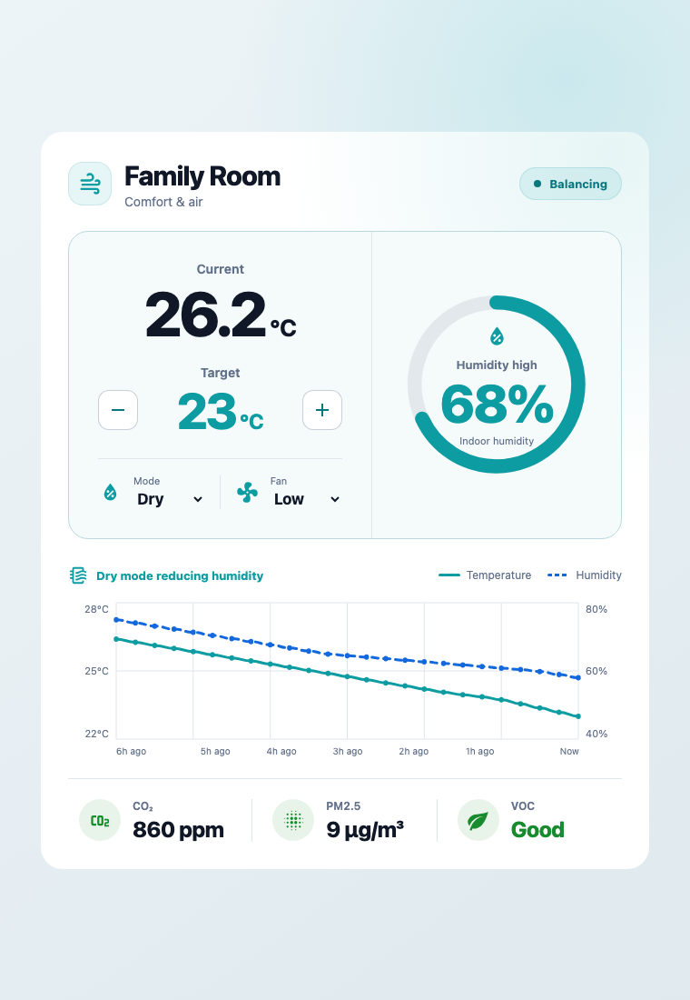

# Climate & Air Card for Home Assistant

A combined climate control, comfort trend and indoor air-quality card for
Home Assistant dashboards.



## Features

- Climate entity for current and target temperature
- Working target-temperature, HVAC-mode and fan-mode controls
- Indoor humidity ring with climate-attribute fallback
- Temperature and humidity history over 1–24 hours
- Mouse, touch and keyboard chart inspection with point-in-time tooltips
- Optional CO₂, PM2.5 and VOC readings
- Native Home Assistant visual configuration
- Responsive light and dark themes
- HACS-compatible packaging

## Configuration

```yaml
type: custom:climate-air-card
title: Family Room
entity: climate.family_room
humidity_entity: sensor.family_room_humidity
co2_entity: sensor.family_room_co2
pm25_entity: sensor.family_room_pm25
voc_entity: sensor.family_room_voc
history_hours: 6
show_history: true
```

Only `entity` is required. If `humidity_entity` is omitted, the card uses the
climate entity's `current_humidity` or `humidity` attribute when available.
The three air-quality entities are optional.

## HACS installation

Until the card is included in the default HACS catalogue:

1. Open HACS and select **Custom repositories**.
2. Add `https://github.com/halfbuilthq/climate-and-air` as a **Dashboard**
   repository.
3. Install **Climate & Air Card** and reload Home Assistant.
4. Add the card from Home Assistant's card picker.

## Development

```sh
npm install
npm run dev
```

Run all tests and build the production bundle:

```sh
npm run check
```

The bundle is emitted to `dist/climate-air-card.js`.

## Manual installation

1. Copy `dist/climate-air-card.js` to `<config>/www/climate-air-card.js`.
2. Add `/local/climate-air-card.js` as a JavaScript module dashboard resource.
3. Add **Climate & Air Card** from Home Assistant's card picker.

## License

[MIT](LICENSE)
